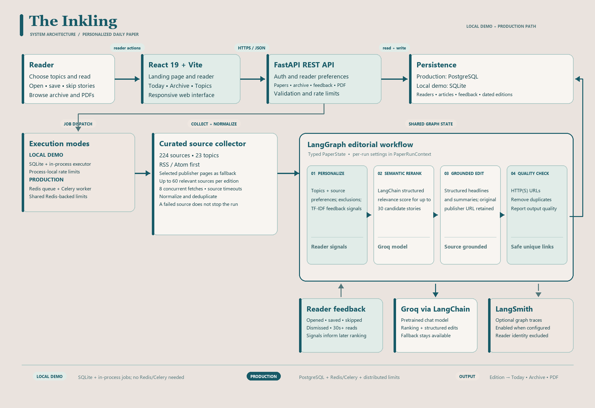

# The Inkling — hackathon demo video

**Target runtime:** 4 minutes 30 seconds  
**Format:** 16:9 screen recording with voice-over; one brief on-camera opening is optional  
**Core message:** A personal newspaper that helps people follow the news without losing the source.

## Recording setup

1. Open the local demo at `http://localhost:5174/`. The entry page is the Inkling landing page.
2. Click **Sign in**. This demo sign-in is local only: use `judge@example.com` and `morning-demo` (or any valid email and password of at least six characters). The form does not send or store those values. It opens the shared demo reader.
3. Keep a second tab ready at `http://localhost:5174/?view=reader` in case you need to jump directly to the reader.
4. Record the actual product UI. Use the architecture diagram in this folder for the architecture segment. Do not show `.env`, API keys, terminal history, or personal browser data.
5. The local demo may show an already-prepared edition. Describe it as the demo edition; do not imply a fresh Groq call or a live LangSmith trace unless you have verified those during recording.

## Timed script and shot list

### 0:00–0:20 — The problem

**Picture:** Start on the generated landscape intro, then cut to the landing page. Keep the title over the video itself in the editor rather than asking a video model to render text.

**Voice-over:**

> Every morning, the news arrives as a flood: dozens of sources, endless tabs, and no clear way to follow what matters. The Inkling turns that flood into one personal paper—and keeps every story connected to the publisher behind it.

**On-screen title:** `The Inkling` / `A clearer way to follow the news`

### 0:20–0:45 — The product

**Picture:** Hold on the landing hero, then scroll past “How it works” and the topic chips. Return to the top before clicking **Sign in**.

**Voice-over:**

> Readers choose the subjects they care about. The Inkling gathers reporting from a curated network of publishers, public institutions, and research sources, then prepares a concise daily edition. This is not a replacement for journalism: every story leads back to its original source.

### 0:45–1:00 — Enter the demo

**Picture:** Show the sign-in screen. Enter `judge@example.com` and `morning-demo`, then submit. Keep the local-demo notice visible for a moment.

**Voice-over:**

> I’m entering through the local demo flow. No account is created and these values are not sent anywhere. In a deployed environment, the same reader flow uses the API’s account authentication.

### 1:00–1:38 — Today’s paper

**Picture:** Show the top story, publisher name, summary, and original-story link. Scroll through the edition; point out **Save**, **Skip**, and PDF actions where visible.

**Voice-over:**

> Here is today’s paper. The lead story keeps its publisher attribution and link in view. Readers can open the original report, save a story, or skip it. Those choices become useful feedback for future ranking; the application stores edition snapshots so readers can return to earlier papers.

### 1:38–2:05 — Personalization

**Picture:** Open **Topics**. Show topic groups, selected topics, story-count control, and the editing preference. Save the preferences, then return to Today’s paper.

**Voice-over:**

> The editorial desk is reader-controlled. Choose topics, adjust the length, and decide whether to use AI editing. The system starts with transparent topic and source matches, then can learn from saved, skipped, and longer-read stories. It combines those signals with a lightweight TF-IDF feedback model.

### 2:05–2:25 — The archive

**Picture:** Open **Archive**. Open a past issue if one is present; show the PDF action on an edition if available.

**Voice-over:**

> Each edition is saved by reader and date. The archive makes the product useful beyond one session, and the print-ready PDF keeps publisher links with the paper.

### 2:25–3:45 — System design

**Picture:** Show `architecture-diagram.png`. Trace the arrows from browser to API, ingestion, graph, and saved edition. Highlight the demo/production split and the four graph nodes.

**Voice-over:**

> Under the interface, React and Vite talk to a FastAPI service. The API owns reader preferences, editions, archive access, feedback, and PDF delivery. It validates requests and applies rate limits. PostgreSQL and Redis with Celery are the production persistence and job-queue path. For this laptop demo, SQLite and a small in-process executor keep setup simple; the screen you’re seeing is still driven by the same API and edition workflow.

> A paper build selects sources for the reader’s topics. The catalogue contains 224 curated sources across 23 topics. RSS and Atom are preferred, with selected publisher pages as a fallback. Fetches are bounded to eight concurrent sources, each request has a timeout, and one failed publisher does not cancel the rest.

> The collected articles enter a LangGraph workflow as typed shared paper state. First, the personalization ranker applies topic, source, exclusion, and feedback signals. Next, a LangChain semantic reranker can score up to 30 candidates with the configured Groq model. The editor returns structured headlines and summaries while preserving each original URL. A final quality node removes duplicate or unsafe URLs before the edition snapshot is saved.

### 3:45–4:12 — Reliability and observability

**Picture:** Highlight the graph and sidecar boxes for model fallback, rate limits, and LangSmith. If a LangSmith project is available, cut to a real trace; otherwise stay on the diagram.

**Voice-over:**

> The model is one part of the pipeline, not a single point of failure. If a model call is unavailable, the deterministic ranking and publisher-provided text remain available. LangSmith can trace graph runs when credentials are configured, and reader identity is kept out of those traces. In production, the Redis-backed queue and rate limiter let the API return quickly while background work continues.

### 4:12–4:30 — Close

**Picture:** Return to the landing page, then finish on the Inkling wordmark over the generated landscape clip.

**Voice-over:**

> The Inkling brings together the parts of reading that should work together: personal relevance, a clear editorial path, and a direct line back to the source. Less time sorting feeds. More time understanding the stories that matter.

**End card:** `The Inkling` / `Your interests. A paper of your own.`

## Architecture walkthrough notes

- **Client:** React 19 and Vite; responsive landing page and reader for Today, Archive, and Topics.
- **API:** FastAPI routes for authentication, preferences, paper generation/status, feedback, archive, and PDF export.
- **Production jobs:** API enqueues date-keyed work in Redis/Celery; the worker collects sources, runs the graph, and writes the edition. The local demo uses SQLite, an in-process executor, and process-local rate counters instead.
- **Ingestion:** Topic-aware selection from 224 curated sources across 23 topics; RSS/Atom first, selected HTML listings as fallback; max eight concurrent requests and per-source timeouts; up to 60 relevant sources per build.
- **Graph state:** LangGraph nodes exchange a typed `PaperState`; immutable model/runtime settings are in `PaperRunContext`.
- **Personalization:** Topic and source matches plus exclusions, then a local TF-IDF similarity model for positive/negative reader feedback.
- **LLM calls:** LangChain structured outputs with Groq for semantic ranking (bounded to 30 candidates) and source-grounded editing of selected stories. The system does not train a custom deep-learning model; it uses a configured pretrained model plus a lightweight feedback ranker.
- **Quality and resilience:** Final URL scheme and deduplication checks; deterministic/source-text fallbacks when model calls fail; per-reader/date uniqueness for the daily edition.
- **Observability:** Application logs plus optional LangSmith graph traces. Never put keys or private credentials on screen.

## Video-generation prompt

Use this prompt for a 8–10 second 16:9 intro or transition clip. Record the live application separately and edit it into the demo; generated footage should not imitate or fabricate product screens.

> Create a restrained, hand-drawn editorial landscape for a thoughtful digital newspaper brand. A still lake sits between layered, mist-soft teal mountains; pine-covered rocky shores frame both edges; two elegant cranes glide slowly across a warm cream paper sky. Static wide camera, gentle ink-and-watercolor texture, subtle natural grain, delicate movement only in the birds and drifting mist. Palette: warm paper cream `#EAE3DE`, deep editorial teal `#175A67`, muted sage, and a small touch of pale stone. Calm, intelligent, contemporary, and human; premium independent-journalism art direction, not fantasy, not corporate stock footage. Leave generous quiet space in the center-left for a title to be added later in editing. Seamless 10-second loop, 16:9, high detail, consistent composition from first to last frame. No text, no letters, no logos, no interface, no watermark, no camera movement, no fast cuts, no extra birds, no photorealistic people.

**Negative prompt:** `text, typography, subtitles, logos, watermark, UI, charts, dashboards, newspapers with readable print, camera shake, zoom, pans, rapid motion, oversaturated colors, neon, harsh contrast, extra limbs or malformed birds, flicker, jump cuts`.

**Edit note:** Add the real Inkling title and captions in the video editor after generation. This keeps spelling crisp and lets the actual application recording remain the source of truth.

## Judge Q&A notes

- **What is the AI contribution?** A hybrid pipeline: topic and feedback ranking, a lightweight TF-IDF relevance model, and optional pretrained-model reranking and editing. The project does not claim to train a new foundation model.
- **How do you limit made-up content?** Editorial prompts constrain output to supplied publisher details and require the original URL to remain unchanged. The final node checks URL schemes and duplicates. These checks improve guardrails; they are not a substitute for independent fact-checking.
- **What happens when a publisher or model is unavailable?** Source failures are isolated and time-bounded. If the model call fails, deterministic ordering and publisher text still provide a usable paper.
- **How does it scale beyond a laptop demo?** The production path moves edition generation to Celery through Redis, stores durable state in PostgreSQL, and uses Redis-backed rate limits. The demo path intentionally substitutes SQLite and an in-process executor.
- **What would you measure next?** Human-rated relevance and source diversity, publisher-link validity, generation latency, source coverage, and fallback frequency. These are proposed evaluation metrics, not existing measured results.
